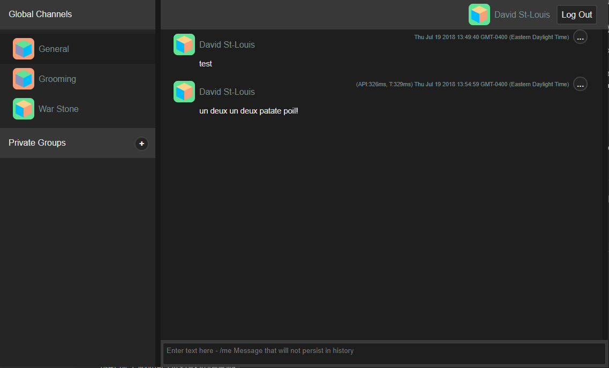

# BCChat

Test chat app built in ReactJS that uses brainCloud Real-time Tech Tech (RTT).



### How to test this app yourself

#### Prerequisites
If you don't have it already, install NodeJS https://nodejs.org/.

[optional] We recommend to install Visual Studio Code https://code.visualstudio.com/.

#### App setup
1. Create a new app in the portal if you don't already have one here: https://portal.braincloudservers.com
2. In **Advanced Settings** of the portal, check "**Real-time Tech (RTT) Enabled**"
3. In **Messaging - Chat** section of the portal, enable "**Chat Service Enabled**", then click save.
4. In **Messaging - Chat Channels** Channels section of the portal, create some new global chat channels to be visible in the app.

#### Running locally
1. Clone this repository
2. Open Terminal into the `bcchat` folder and type:
   ```
   npm install
   ```
3. Set up your app. Log in, pick your team and app, and it writes `src/braincloud.config.js`:
   ```
   npx @braincloud/client setup
   ```
   In VS Code, open this folder and run Terminal → Run Task… → **brainCloud: Setup** instead (**brainCloud: Refresh config** re-fetches the config from your saved login without the browser).
4. Then type:
   ```
   npm start
   ```

The terminal should launch BCChat into a tab in your browser, and it should just work! Enjoy.
